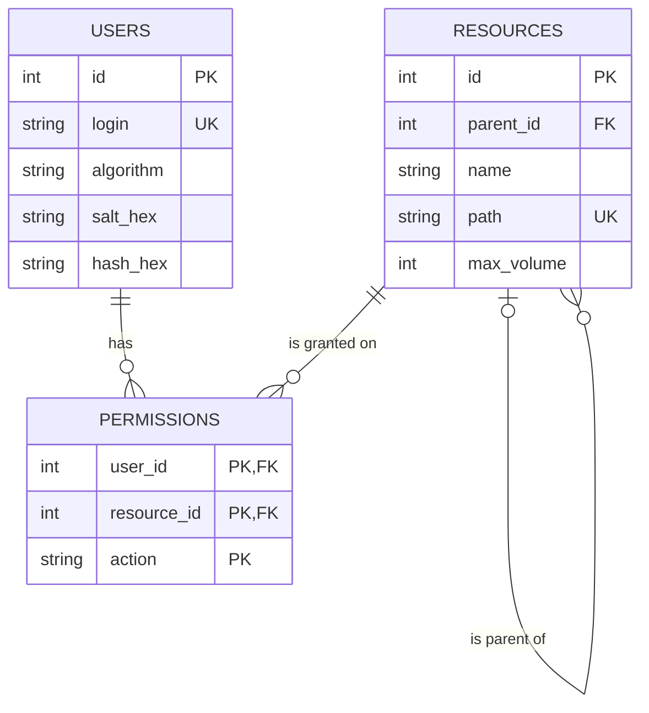
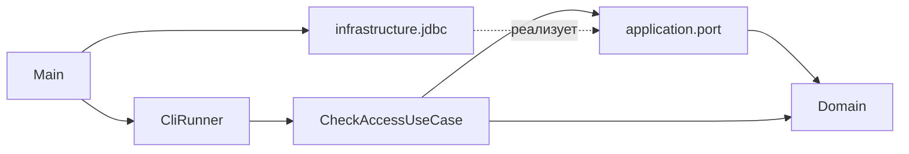

# Хранение данных в базе данных: план и описание

Документ описывает переход от данных, записанных в коде, к хранению в встроенной файловой СУБД через JDBC.
Логика приложения (проверка пароля, прав, объёма) и формат вызова не меняются.

## 1. Выбор СУБД

Выбрана **H2** (редакция Embedded, файловый режим), версия 2.2.220.

| Критерий | H2 | SQLite (xerial `sqlite-jdbc`) |
|----------|----|-------------------------------|
| Зависимости | один файл `h2-*.jar`: драйвер, движок и консольные утилиты | драйвер `sqlite-jdbc` плюс вспомогательная библиотека логирования |
| Заполнение базы | встроенная утилита `org.h2.tools.RunScript` (запускается из `init-db.sh` одной командой) | нужен отдельный клиент `sqlite3` или своя загрузка скриптов |
| Ограничения целостности | внешние ключи, `CHECK` с регулярными выражениями, каскадное удаление | внешние ключи нужно включать отдельной командой при каждом подключении, `CHECK` с регулярными выражениями нет |
| Работа в тестах | база в памяти (`jdbc:h2:mem:`) с теми же SQL-скриптами | возможна, но без `REGEXP_LIKE` |

Главные причины: один jar вместо двух, готовая утилита для заполнения (на неё указывает задание) и проверка формата имён ресурсов самой базой.

## 2. Сущности, атрибуты и связи

В предметной области три сущности: пользователь, ресурс и право доступа.

### 2.1. `users` (пользователи)

| Атрибут | Тип | Ограничения | Смысл |
|---------|-----|-------------|-------|
| `id` | `INT` | первичный ключ, автоинкремент | идентификатор |
| `login` | `VARCHAR(100)` | `NOT NULL`, `UNIQUE` | логин |
| `algorithm` | `VARCHAR(20)` | `NOT NULL` | алгоритм хэширования пароля (`SHA-256`) |
| `salt_hex` | `VARCHAR(64)` | `NOT NULL` | случайная соль в hex |
| `hash_hex` | `VARCHAR(128)` | `NOT NULL` | хэш `SHA-256(соль + пароль)` в hex |

Пароль в открытом виде не хранится нигде.

### 2.2. `resources` (ресурсы, иерархия)

| Атрибут | Тип | Ограничения | Смысл |
|---------|-----|-------------|-------|
| `id` | `INT` | первичный ключ, автоинкремент | идентификатор |
| `parent_id` | `INT` | внешний ключ на `resources.id`, может быть `NULL` | родительский ресурс; `NULL` у ресурсов верхнего уровня |
| `name` | `VARCHAR(20)` | `NOT NULL`, `CHECK` по `^[A-Za-z0-9_]{1,20}$` | имя ресурса (правило из задания) |
| `path` | `VARCHAR(500)` | `NOT NULL`, `UNIQUE` | полный путь через точки, например `A.B.C` |
| `max_volume` | `INT` | `NOT NULL`, `CHECK (max_volume >= 0)` | максимальный объём ресурса |

Столбец `path` хранится целиком (контролируемая денормализация): ресурс по пути из командной строки находится одним запросом по уникальному индексу, без рекурсивного обхода дерева. Согласованность пути и иерархии (`path` = путь родителя + `.` + `name`) проверяется тестом `SchemaTest`.

### 2.3. `permissions` (права доступа)

| Атрибут | Тип | Ограничения | Смысл |
|---------|-----|-------------|-------|
| `user_id` | `INT` | внешний ключ на `users.id`, `ON DELETE CASCADE` | кому выдано |
| `resource_id` | `INT` | внешний ключ на `resources.id`, `ON DELETE CASCADE` | на какой ресурс |
| `action` | `VARCHAR(10)` | `CHECK (action IN ('READ','WRITE','EXECUTE'))` | разрешённое действие |

Первичный ключ составной: `(user_id, resource_id, action)`. Одна строка равна одному разрешённому действию, поэтому таблица в третьей нормальной форме, а набор действий не хранится строкой через запятую. Наследование прав потомкам в базе не хранится: это бизнес-правило, оно остаётся в `PermissionPolicy` (домен).

### 2.4. Связи

* `users` 1 : N `permissions`: у пользователя может быть много прав.
* `resources` 1 : N `permissions`: на ресурс может быть выдано много прав.
* Вместе это связь «многие ко многим» между пользователями и ресурсами с атрибутом `action`.
* `resources` 1 : N `resources` (рекурсивная): ресурс может иметь много дочерних, у каждого не более одного родителя. Ресурс с дочерними нельзя удалить (внешний ключ без каскада).

## 3. ER-диаграмма

## 4. Техническая сторона

### 4.1. Драйвер и подключение

* Драйвер входит в `h2-2.2.220.jar`; код программы использует только стандартные `java.sql.*` (`Connection`, `PreparedStatement`, `ResultSet`, `DriverManager`). Классов `org.h2.*` в исходниках приложения нет, поэтому при замене СУБД меняются только URL, драйвер и SQL-скрипты.
* Драйвер регистрируется автоматически (механизм `META-INF/services/java.sql.Driver`). При сборке `app.jar` содержимое `h2-*.jar` распаковывается в итоговый «толстый» jar вместе с этим файлом, поэтому `java -jar app.jar` работает без указания classpath.
* Адрес подключения строится в `DatabaseUrls`: `jdbc:h2:file:<абсолютный путь без расширения>;IFEXISTS=TRUE`, пользователь `sa`, пароль пустой (локальный учебный файл).
* `IFEXISTS=TRUE` важен: без него H2 молча создаёт пустую базу, если файла нет. Тогда отсутствие базы выглядело бы как ошибка SQL («таблицы не найдены», код 10), а не как ошибка подключения (код 9).
* Файл базы по умолчанию `./data/access.mv.db` (путь относительно текущего каталога). Другой путь задаётся переменной окружения `ACCESS_DB_PATH` (без расширения). Формат вызова программы (флаги) не меняется.

### 4.2. Закрытие ресурсов

* `Connection`, `PreparedStatement` и `ResultSet` закрываются конструкцией Kotlin `use` (аналог `try-with-resources`), в том числе при ошибках.
* Соединение одно на запуск программы: `Database` открывает его лениво при первом запросе и закрывает в `close()`. Вывод справки базы не касается.
* В `main` результат вычисляется внутри `Database(...).use { ... }`, а `exitProcess` вызывается после него: иначе завершение процесса пропустило бы закрытие.
* Все запросы с данными пользователя параметризованные (`PreparedStatement`), конкатенации SQL нет; в тестах проверена устойчивость к вводу вида `alice' OR '1'='1`.

### 4.3. Ошибки и коды возврата

| Ситуация | Исключение на границе порта | Результат сценария | Код |
|----------|-----------------------------|--------------------|-----|
| Нет файла базы, неверный пароль к базе, нет драйвера, файл занят другим процессом | `StorageException(CONNECTION)` | `StorageFailure(CONNECTION)` | 9 |
| `SQLException` при выполнении запроса (нет таблиц, нарушена схема) | `StorageException(QUERY)` | `StorageFailure(QUERY)` | 10 |
| В базе лежит некорректное значение (неизвестное действие, неверный путь) | `StorageException(QUERY)` | `StorageFailure(QUERY)` | 10 |

`SQLException` дальше слоя `infrastructure.jdbc` не выходит: сценарий и адаптер ничего не знают про JDBC. Так как пользователя ищут первым, недоступная база даёт код 9 раньше любых проверок формата.

### 4.4. Скрипты и заполнение базы

| Файл | Назначение |
|------|------------|
| `scripts/init.sql` | схема: таблицы, ключи, ограничения, индекс |
| `scripts/fill.sql` | тестовые данные: пользователи (соль и хэш), дерево ресурсов, права |
| `scripts/init-db.sh` | создаёт файл базы заново и выполняет оба скрипта утилитой `org.h2.tools.RunScript` |
| `scripts/fetch-deps.sh` | скачивает `kotlinx-cli`, H2 и JUnit в `lib/` и проверяет SHA-1 |
| `scripts/build.sh`, `run.sh`, `test.sh`, `build-tests.sh`, `run-tests.sh` | сборка, запуск, сквозные и модульные тесты |

Механизм заполнения: `init-db.sh` выполняет команду вида `java -cp lib/h2-2.2.220.jar org.h2.tools.RunScript -url jdbc:h2:file:./data/access -user sa -password "" -script scripts/init.sql`, затем то же для `fill.sql`. Идентификаторы создаёт сама база, связи в `fill.sql` задаются по путям (`SELECT id FROM resources WHERE path = 'A'`). Хэши паролей в `fill.sql` получены инструментом `tools/GenHash.kt`; пароли тестовых пользователей: `alice / qwerty`, `bob / hunter2`.

Скрипты `.sql` содержат только ASCII, чтобы кодировка консоли не влияла на выполнение.

### 4.5. Ограничения

* Встроенная база H2 открывается одним процессом: если два экземпляра программы одновременно обращаются к одному файлу, второй получит ошибку подключения (код 9). Для последовательных запусков и скриптов ограничения нет. Режим `AUTO_SERVER=TRUE` снял бы его ценой запуска сетевого сервера, это за рамками работы.
* Учётные данные базы тривиальны (`sa` без пароля): база локальная учебная, защищает её только доступ к файлу.
* Хэширование паролей остаётся SHA-256 с солью по заданию первой лабораторной; для реальных систем нужны медленные алгоритмы (PBKDF2, Argon2).

## 5. Изменения в программном коде

Принцип: домен и сценарий не знают о базе, а вся работа с JDBC находится во внешнем слое. Благодаря портам из прежней архитектуры (`UserRepository`, `ResourceRepository`) логика проверки доступа не менялась.

### 5.1. Новые компоненты

| Компонент | Слой | Зачем нужен |
|-----------|------|-------------|
| `StorageException`, `StorageFailureKind` | application (порты) | Единый способ сообщить о сбое хранилища, не раскрывая JDBC |
| `AccessResult.StorageFailure` | application | Результат сценария «проверить не удалось»: сценарий возвращает значение, как и для отказов |
| `Database` | infrastructure.jdbc | Ленивое соединение, закрытие, перевод `SQLException` в `StorageException` |
| `DatabaseUrls` | infrastructure.jdbc | Построение URL H2 (абсолютный путь, `IFEXISTS`) |
| `JdbcUserRepository` | infrastructure.jdbc | Реализует `UserRepository`: пользователь с учётными данными и правами |
| `JdbcResourceRepository` | infrastructure.jdbc | Реализует `ResourceRepository`: ресурс и максимальный объём по пути |
| `ExitCode.DB_CONNECTION_ERROR` (9), `DB_QUERY_ERROR` (10) | adapter.cli | Новые коды возврата |
| `scripts/init.sql`, `fill.sql`, `init-db.sh` | скрипты | Создание и заполнение базы |

### 5.2. Изменённые компоненты

| Компонент | Что изменилось |
|-----------|----------------|
| `CheckAccessUseCase` | перехватывает `StorageException` и возвращает `StorageFailure`; бизнес-логика проверок не менялась |
| `ExitCodeMapper` | отображает `StorageFailure` в коды 9 и 10 |
| `HelpPrinter` | справка описывает новые коды, файл базы и переменную `ACCESS_DB_PATH` |
| `Main` | создаёт `Database` и JDBC-репозитории, закрывает базу, затем завершает процесс |
| `build.sh` | включает драйвер H2 в итоговый jar |

### 5.3. Удалённые компоненты

`InMemoryUserRepository` и `InMemoryResourceRepository`: данные в коде больше не хранятся, их заменили скрипты `.sql`. Не изменились: весь пакет `domain`, `CliArgumentsParser`, `CliRunner`, `Sha256PasswordHasher`.

### 5.4. Зависимости между слоями

Проверяемое правило: `java.sql` и `org.h2` не встречаются нигде, кроме `infrastructure/jdbc`; в `domain` и `application` нет `kotlinx.cli`, `exitProcess`, `println`, `java.sql`.

### 5.5. Тесты

Модульные тесты (JUnit 5) используют настоящую H2 в памяти со скриптами `init.sql` и `fill.sql`, поэтому проверяются и SQL, и схема.

| Тестовый класс | Что проверяет | Тестов |
|----------------|---------------|--------|
| `DatabaseTest` | подключение, повторное использование и закрытие соединения, ошибки подключения и запроса | 14 |
| `DatabaseUrlsTest` | формат URL | 5 |
| `JdbcUserRepositoryTest` | поиск пользователя, права, SQL-инъекции, ошибки, повреждённые данные | 19 |
| `JdbcResourceRepositoryTest` | поиск ресурса, ошибки | 10 |
| `SchemaTest` | ограничения схемы и целостность данных `fill.sql` | 15 |
| `CheckAccessUseCaseStorageFailureTest` | сбои хранилища превращаются в результат | 6 |
| `CliRunnerTest` | коды 0–10 в одном процессе, «тихая» работа при ошибках базы | 20 |
| остальные классы (домен, парсер, коды, хэшер и т.д.) | без изменений по смыслу | 128 |
| **Итого** | | **217** |

Сквозные тесты `scripts/test.sh` создают тестовую базу в `build/test-db`, запускают `app.jar` и проверяют все коды 0–10 (в том числе 9: нет файла базы, 10: база без таблиц), всего 16 кейсов.
